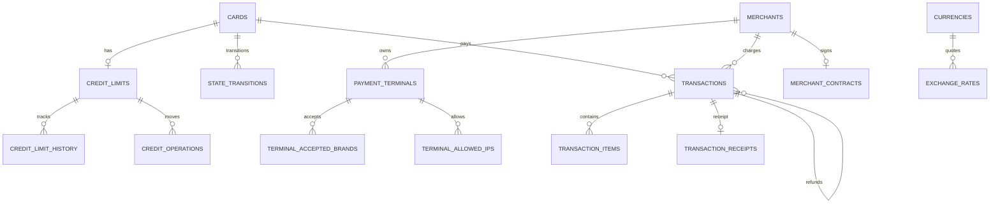

# 🗄️ Card Management Database

Repositorio centralizado de migraciones y schema de base de datos para el **Sistema de Gestión de Tarjetas**.

[](https://www.postgresql.org/)
[](https://flywaydb.org/)
[](https://www.docker.com/)
[]()

---

## 📋 Tabla de Contenidos

- [Descripción](#-descripción)
- [Tecnologías](#-tecnologías)
- [Arquitectura](#️-arquitectura)
- [Quick Start](#-quick-start)
- [Comandos Disponibles](#️-comandos-disponibles)
- [Estructura del Proyecto](#-estructura-del-proyecto)
- [Migraciones](#️-migraciones)
- [Schema de Base de Datos](#-schema-de-base-de-datos)
- [Validación](#-validación)
- [Convenciones](#-convenciones)
- [Ambientes](#-ambientes)
- [Backup & Restore](#-backup--restore)
- [Troubleshooting](#-troubleshooting)

---

## 📖 Descripción

Este repositorio contiene:

- ✅ **Migraciones de base de datos** versionadas con Flyway
- ✅ **Schema completo** para el sistema de gestión de tarjetas
- ✅ **Docker Compose** para levantar entorno completo
- ✅ **Scripts de automatización** con Makefile
- ✅ **Seeds** de datos de prueba para desarrollo y staging

**Separación de responsabilidades:** Este repositorio maneja **SOLO** el schema de base de datos. Las aplicaciones Java están en el repositorio `card-management-service`.

---

## 🚀 Tecnologías

| Tecnología | Versión | Propósito |
|------------|---------|-----------|
| **PostgreSQL** | 16-alpine | Base de datos relacional |
| **Flyway** | 11.1.0 | Migraciones versionadas |
| **Docker** | 20.10+ | Containerización |
| **Docker Compose** | 2.0+ | Orquestación de servicios |
| **PgAdmin 4** | latest | Interfaz web de gestión |
| **Make** | 4.0+ | Automatización de tareas |

---

## 🏗️ Arquitectura

### **Tablas por servicio**

Una sola base (`card_management_db`, schema `public`) compartida por los servicios. Cada tabla pertenece a un servicio:

```
card_management_db (PostgreSQL 16) — schema public
│
├── card-data
│   ├── cards                         (V1)
│   ├── card_audit                    (V3)
│   ├── outbox_events                 (V7)
│   └── card_data_processed_events    (V8)
│
├── card-limits
│   ├── credit_limits                 (V2)
│   ├── credit_limit_history          (V3)
│   ├── credit_operations             (V6)
│   └── credit_limit_outbox_events    (V7)
│
├── card-lifecycle
│   └── state_transitions             (V3)
│
├── merchant
│   ├── merchants                     (V4)
│   ├── payment_terminals             (V4)
│   ├── terminal_accepted_brands      (V4)
│   ├── terminal_allowed_ips          (V4)
│   └── merchant_contracts            (V4)
│
├── payment-processing
│   ├── transactions                  (V5)
│   ├── transaction_items             (V5)
│   ├── transaction_receipts          (V5)
│   ├── payment_credit_operations     (V6)
│   └── payment_outbox_events         (V7)
│
├── card-currency
│   ├── currencies                    (V9)
│   └── exchange_rates                (V9)
│
└── flyway_schema_history             (Flyway)
```

Toda la lógica (cálculo de crédito disponible, validación de transiciones, `updated_at`, etc.) vive en los servicios: el schema **no tiene triggers, views ni functions**. Sí tiene constraints (`CHECK`, `UNIQUE`, `FOREIGN KEY`) que protegen la consistencia de los datos.

### **Relaciones entre Tablas**



Sin FK (a propósito): `card_audit`, las tablas de outbox, `card_data_processed_events`, `payment_credit_operations` (la transacción puede no haberse guardado nunca) y `transactions.exchange_rate_id` (la cotización es de otro servicio).

---

## ⚡ Quick Start

### **Requisitos Previos**

```bash
docker --version          # Docker 20.10+
docker compose version    # Docker Compose v2 (plugin). El v1 (docker-compose) no es compatible
make --version            # GNU Make 4.0+ (opcional, pero recomendado)
```

### **Instalación Rápida**

```bash
# 1. Clonar repositorio
git clone https://github.com/unisono/card-management-database.git
cd card-management-database

# 2. Levantar servicios
docker compose up -d postgres pgadmin

# 3. Ejecutar migraciones
docker compose up flyway

# 4. Verificar
docker exec -it card-db-postgres psql -U postgres -d card_management_db -c "\dt"
```

### **Con Make (Recomendado)**

```bash
make up               # Levantar PostgreSQL y PgAdmin
make migrate-docker   # Ejecutar migraciones
make seed-dev         # Cargar datos de prueba (opcional)
make psql             # Verificar
```

---

## 🛠️ Comandos Disponibles

### **Docker**

```bash
make up              # Levantar PostgreSQL + PgAdmin
make up-all          # Levantar todos los servicios (incluye monitoring)
make down            # Detener servicios (mantiene datos)
make down-volumes    # Detener y eliminar volúmenes ⚠️
make restart         # Reiniciar servicios
make logs            # Ver logs de todos los servicios
make logs-postgres   # Ver logs solo de PostgreSQL
make logs-flyway     # Ver logs de Flyway
make ps              # Ver estado de servicios
```

### **Flyway (Migraciones)**

```bash
make migrate         # Ejecutar migraciones pendientes
make migrate-docker  # Ejecutar migraciones con Docker
make info            # Ver estado de migraciones
make validate        # Validar migraciones
make repair          # Reparar historial de Flyway
make clean           # Limpiar BD ⚠️ (BORRA TODO)
```

### **Base de Datos**

```bash
make psql            # Conectar a PostgreSQL con psql
make psql-root       # Conectar como usuario postgres
make create-db       # Crear base de datos
make drop-db         # Eliminar base de datos ⚠️
make reset-db        # Drop + Create + Migrate
make health          # Verificar salud de PostgreSQL
make stats           # Ver estadísticas de tablas
make connections     # Ver conexiones activas
```

### **Backup & Restore**

```bash
make backup                     # Crear backup (.dump)
make backup-sql                 # Crear backup (.sql)
make restore BACKUP_FILE=path   # Restaurar backup
make list-backups               # Listar backups disponibles
```

### **Seeds (Datos de Prueba)**

```bash
make seed-dev        # Cargar datos de prueba (DEV)
make seed-staging    # Cargar datos de staging
make clean-seeds     # Borrar datos de seeds (mantiene schema)
```

Detalle de los seeds de desarrollo en [`seeds/dev/README.md`](seeds/dev/README.md).

### **Mantenimiento**

```bash
make vacuum          # Ejecutar VACUUM ANALYZE
make analyze         # Actualizar estadísticas
make clean-logs      # Limpiar logs de Docker
make prune           # Limpiar recursos Docker no usados
```

### **Desarrollo**

```bash
make new-migration name=description    # Crear nueva migración
make lint-migrations                   # Validar sintaxis SQL
```

---

## 📂 Estructura del Proyecto

```
card-management-database/
├── README.md                    # Este archivo
├── docker-compose.yml           # Orquestación de servicios
├── Dockerfile                   # Imagen de Flyway con migraciones y configuración
├── flyway.conf                  # Configuración de Flyway
├── Makefile                     # Comandos de automatización
├── .gitignore                   # Archivos ignorados por Git
│
├── .github/workflows/
│   └── flyway-migrate.yml       # CI: migrate + validate sobre PostgreSQL limpio
│
├── migrations/                  # ⭐ Migraciones de Flyway (V1 a V9)
│
├── rollback/                    # Scripts de rollback manual (R{n}__rollback_v{version}.sql)
│
├── seeds/                       # Datos de prueba
│   ├── dev/
│   │   ├── 001_test_cards.sql
│   │   ├── 002_test_credit_limits.sql
│   │   ├── 003_test_state_transitions.sql
│   │   ├── 004_test_exchange_rates.sql
│   │   └── README.md
│   ├── staging/
│   │   └── 001_staging_data.sql
│   └── prod/
│       └── README.md
│
├── scripts/                     # Scripts útiles
│   ├── create_database.sh
│   ├── drop_database.sh
│   ├── backup.sh
│   └── restore.sh
│
├── docs/                        # Documentación
│   ├── schema_diagram.png
│   ├── migration_guide.md
│   └── rollback_guide.md
│
└── backups/                     # Backups de BD (ignorado por Git)
```

---

## 🗂️ Migraciones

### **Estructura de Migraciones**

Cada migración crea las tablas de un dominio con su forma final: columnas, constraints, índices y comentarios en el mismo `CREATE`.

```
migrations/
├── V1__create_cards_table.sql                       card-data
│   └── cards                       (4 CHECK, 5 índices)
│
├── V2__create_credit_limits_table.sql               card-limits
│   └── credit_limits               (FK → cards, 4 CHECK, 4 índices)
│
├── V3__create_history_and_audit_tables.sql
│   ├── state_transitions           (FK → cards, 7 índices)
│   ├── credit_limit_history        (FK → credit_limits, 4 CHECK, 8 índices)
│   └── card_audit                  (2 índices)
│
├── V4__create_merchant_tables.sql                   merchant
│   ├── merchants
│   ├── payment_terminals           (FK → merchants)
│   ├── terminal_accepted_brands    (FK → payment_terminals)
│   ├── terminal_allowed_ips        (FK → payment_terminals)
│   └── merchant_contracts          (FK → merchants)
│
├── V5__create_transaction_tables.sql                payment-processing
│   ├── transactions                (FK → cards, merchants, transactions)
│   ├── transaction_items           (FK → transactions)
│   └── transaction_receipts        (FK → transactions)
│
├── V6__create_credit_operations_tables.sql
│   ├── credit_operations           (FK → credit_limits)     card-limits
│   └── payment_credit_operations                            payment-processing
│
├── V7__create_outbox_tables.sql
│   ├── outbox_events                                        card-data
│   ├── payment_outbox_events                                payment-processing
│   └── credit_limit_outbox_events                           card-limits
│
├── V8__create_card_data_processed_events_table.sql  card-data
│   └── card_data_processed_events
│
└── V9__create_currency_tables.sql                   card-currency
    ├── currencies                  (+ ARS, USD, EUR)
    └── exchange_rates              (FK → currencies)
```

> **Nota:** el historial se consolidó en estas 9 migraciones durante la etapa de desarrollo (antes eran V1 a V21 con `ALTER`s encadenados). Una base creada con las migraciones anteriores no valida contra estas: hay que recrearla (`make down-volumes && make up && make migrate-docker`). De acá en adelante, los cambios van **siempre** en migraciones nuevas.

### **Convención de Nomenclatura**

```
V{version}__{description}.sql
```

#### ✅ Ejemplos correctos

```
V1__create_cards_table.sql
V2__create_credit_limits_table.sql
V10__add_benefits_table.sql
V11__alter_cards_add_column_rewards.sql
```

#### ❌ Ejemplos incorrectos

```
V1_create_cards.sql              (solo un guión bajo)
create_cards.sql                 (sin versión)
V1.1__create_cards.sql           (versión decimal)
V1__Create_Cards_Tables.sql      (mayúsculas inconsistentes)
```

### **Orden de Ejecución**

Flyway ejecuta las migraciones en orden numérico: `V1 → V2 → V3 → ... → V9 → V10 → ...`

Una vez ejecutada, **NUNCA** modificar una migración. Si necesitas cambios, crea una nueva:

```sql
-- ❌ NO HACER: Modificar V1__create_cards_table.sql
-- ✅ HACER: Crear nueva migración
V10__alter_cards_add_column_rewards.sql
```

---

## 📊 Schema de Base de Datos

### **Tablas (22)**

| Tabla | Propósito | Servicio | Migración |
|-------|-----------|----------|-----------|
| `cards` | Tarjetas de crédito/débito | card-data | V1 |
| `card_audit` | Auditoría de cambios | card-data | V3 |
| `outbox_events` | Outbox de eventos `card.*` | card-data | V7 |
| `card_data_processed_events` | Eventos ya consumidos (deduplicación) | card-data | V8 |
| `credit_limits` | Límites, consumo, adelantos y saldo a favor | card-limits | V2 |
| `credit_limit_history` | Historial de cambios de límites | card-limits | V3 |
| `credit_operations` | Movimientos de crédito idempotentes | card-limits | V6 |
| `credit_limit_outbox_events` | Outbox de eventos `credit-limit.*` | card-limits | V7 |
| `state_transitions` | Transiciones de estado de tarjetas | card-lifecycle | V3 |
| `merchants` | Comercios | merchant | V4 |
| `payment_terminals` | Terminales de pago (POS, virtual, mobile) | merchant | V4 |
| `terminal_accepted_brands` | Marcas aceptadas por terminal | merchant | V4 |
| `terminal_allowed_ips` | IPs permitidas por terminal | merchant | V4 |
| `merchant_contracts` | Contratos de comercio | merchant | V4 |
| `transactions` | Transacciones (compras, devoluciones, etc.) | payment-processing | V5 |
| `transaction_items` | Ítems de una transacción | payment-processing | V5 |
| `transaction_receipts` | Comprobantes | payment-processing | V5 |
| `payment_credit_operations` | Saga de operaciones de crédito pedidas a card-limits | payment-processing | V6 |
| `payment_outbox_events` | Outbox de eventos de pagos | payment-processing | V7 |
| `currencies` | Monedas aceptadas | card-currency | V9 |
| `exchange_rates` | Cotizaciones por par con vigencia | card-currency | V9 |
| `flyway_schema_history` | Control de migraciones | Flyway | — |

### **Índices (96)**

Incluye las PKs, los `UNIQUE` y los 2 de `flyway_schema_history`. 20 son índices parciales (con `WHERE`).

| Tabla | Índices | | Tabla | Índices |
|-------|---------|-|-------|---------|
| `credit_limit_history` | 9 | | `payment_outbox_events` | 5 |
| `state_transitions` | 8 | | `transaction_receipts` | 5 |
| `transactions` | 8 | | `card_audit` | 3 |
| `merchants` | 7 | | `exchange_rates` | 3 |
| `cards` | 6 | | `payment_credit_operations` | 3 |
| `credit_limits` | 6 | | `card_data_processed_events` | 2 |
| `outbox_events` | 6 | | `credit_operations` | 2 |
| `payment_terminals` | 6 | | `flyway_schema_history` | 2 |
| `credit_limit_outbox_events` | 5 | | `transaction_items` | 2 |
| `merchant_contracts` | 5 | | `currencies`, `terminal_accepted_brands`, `terminal_allowed_ips` | 1 c/u |

**Índices parciales (ejemplos):**

```sql
-- Tarjetas no eliminadas
CREATE INDEX idx_cards_client_id ON cards(client_id) WHERE deleted = false;

-- Lo que lee el relay del outbox: pendientes que no fallaron de forma permanente
CREATE INDEX idx_outbox_events_pending ON outbox_events (id)
    WHERE published_at IS NULL AND failed_at IS NULL;

-- Una sola transición CREATE por tarjeta (consumo idempotente de card.created)
CREATE UNIQUE INDEX uq_state_transitions_create ON state_transitions (card_id)
    WHERE event = 'CREATE';

-- Una sola cotización abierta por par
CREATE UNIQUE INDEX uq_exchange_rates_open_pair
    ON exchange_rates (base_currency, quote_currency) WHERE valid_to IS NULL;
```

### **Foreign Keys (15)**

| Tabla | Referencia | ON DELETE |
|-------|------------|-----------|
| `credit_limits` | `cards` | CASCADE |
| `state_transitions` | `cards` | CASCADE |
| `credit_limit_history` | `credit_limits` | CASCADE |
| `credit_operations` | `credit_limits` | NO ACTION |
| `payment_terminals` | `merchants` | CASCADE |
| `merchant_contracts` | `merchants` | CASCADE |
| `terminal_accepted_brands` | `payment_terminals` | CASCADE |
| `terminal_allowed_ips` | `payment_terminals` | CASCADE |
| `transactions` | `cards` | RESTRICT |
| `transactions` | `merchants` | RESTRICT |
| `transactions` (`original_transaction_id`) | `transactions` | RESTRICT |
| `transaction_items` | `transactions` | CASCADE |
| `transaction_receipts` | `transactions` | CASCADE |
| `exchange_rates` (`base_currency`) | `currencies` | NO ACTION |
| `exchange_rates` (`quote_currency`) | `currencies` | NO ACTION |

### **Check Constraints (25)**

| Tabla | Constraints |
|-------|-------------|
| `cards` | `chk_status`, `chk_type`, `chk_category`, `chk_pin_failed_attempts` |
| `credit_limits` | `chk_monthly_reset_month`, `chk_consumed_not_negative`, `chk_cash_advance_consumed`, `chk_credit_balance` |
| `credit_limit_history` | `chk_limit_type`, `chk_action`, `chk_successful_has_values`, `chk_failed_has_error` |
| `credit_operations` | `chk_credit_operations_status`, `chk_credit_operations_type` |
| `payment_credit_operations` | `chk_payment_credit_operations_status`, `chk_payment_credit_operations_type`, `chk_payment_credit_operations_attempts` |
| `transactions` | `chk_transactions_original_only_refunds` |
| `outbox_events`, `payment_outbox_events`, `credit_limit_outbox_events` | `chk_*_attempts` (1 c/u) |
| `currencies` | `chk_currencies_code` |
| `exchange_rates` | `chk_exchange_rates_pair`, `chk_exchange_rates_rate`, `chk_exchange_rates_validity` |

### **Triggers, Views y Functions**

No hay. El schema solo define tablas, constraints e índices; la lógica está en los servicios.

---

## ✅ Validación

### **Comandos de Validación**

#### **1. Ver todas las tablas**

```bash
docker exec -it card-db-postgres psql -U postgres -d card_management_db -c "\dt"
```

**Output esperado:** 22 tablas

#### **2. Ver todos los índices**

```bash
docker exec -it card-db-postgres psql -U postgres -d card_management_db -c "\di"
```

**Output esperado:** 96 índices

#### **3. Ver Foreign Keys**

```bash
docker exec -it card-db-postgres psql -U postgres -d card_management_db -c "
SELECT
    conrelid::regclass  AS table_name,
    conname             AS constraint_name,
    confrelid::regclass AS foreign_table_name
FROM pg_constraint
WHERE contype = 'f' AND connamespace = 'public'::regnamespace
ORDER BY 1, 2;
"
```

**Output esperado:** 15 Foreign Keys

#### **4. Ver historial de Flyway**

```bash
docker exec -it card-db-postgres psql -U postgres -d card_management_db -c "
SELECT version, description, success
FROM flyway_schema_history
ORDER BY installed_rank;
"
```

**Output esperado:**

```
 version |               description               | success
---------+-----------------------------------------+---------
 1       | create cards table                      | t
 2       | create credit limits table              | t
 3       | create history and audit tables         | t
 4       | create merchant tables                  | t
 5       | create transaction tables               | t
 6       | create credit operations tables         | t
 7       | create outbox tables                    | t
 8       | create card data processed events table | t
 9       | create currency tables                  | t
```

#### **5. Resumen completo de objetos**

```bash
docker exec -it card-db-postgres psql -U postgres -d card_management_db -c "
SELECT 'Tables' AS object_type, COUNT(*)
FROM information_schema.tables WHERE table_schema = 'public' AND table_type = 'BASE TABLE'
UNION ALL
SELECT 'Indexes', COUNT(*)
FROM pg_indexes WHERE schemaname = 'public'
UNION ALL
SELECT 'Foreign Keys', COUNT(*)
FROM information_schema.table_constraints
WHERE constraint_schema = 'public' AND constraint_type = 'FOREIGN KEY'
UNION ALL
SELECT 'Check Constraints', COUNT(*)
FROM pg_constraint WHERE connamespace = 'public'::regnamespace AND contype = 'c'
UNION ALL
SELECT 'Triggers', COUNT(*)
FROM information_schema.triggers WHERE trigger_schema = 'public'
UNION ALL
SELECT 'Views', COUNT(*)
FROM information_schema.views WHERE table_schema = 'public'
UNION ALL
SELECT 'Functions', COUNT(*)
FROM pg_proc p
JOIN pg_namespace n ON p.pronamespace = n.oid
WHERE n.nspname = 'public';
"
```

**Output esperado:**

```
    object_type    | count
-------------------+-------
 Tables            |    22
 Indexes           |    96
 Foreign Keys      |    15
 Check Constraints |    25
 Triggers          |     0
 Views             |     0
 Functions         |     0
```

### **Checklist de Validación**

- [ ] 22 tablas creadas
- [ ] 96 índices
- [ ] 15 Foreign Keys
- [ ] 25 Check Constraints
- [ ] 9 migraciones exitosas (V1 a V9)
- [ ] `make validate` sin errores
- [ ] `make seed-dev` carga sin errores
- [ ] PostgreSQL 16 corriendo
- [ ] PgAdmin accesible en http://localhost:5050

---

## 📐 Convenciones

### **SQL**

```sql
-- ✅ BUENAS PRÁCTICAS

-- 1. Comentarios en español (para este proyecto)
COMMENT ON TABLE cards IS 'Tabla principal de tarjetas';

-- 2. NOT NULL explícito
CREATE TABLE cards (
    id     VARCHAR(36) NOT NULL,
    status VARCHAR(20) NOT NULL DEFAULT 'REQUESTED'
);

-- 3. Constraints con nombre descriptivo
CONSTRAINT chk_status CHECK (status IN ('ACTIVE', 'BLOCKED'));

-- 4. Índices con prefijo idx_ (únicos con uq_)
CREATE INDEX idx_cards_status ON cards(status) WHERE deleted = false;

-- 5. Foreign Keys con nombre fk_ y ON DELETE explícito
CONSTRAINT fk_credit_limits_card
    FOREIGN KEY (card_id) REFERENCES cards(id)
    ON DELETE CASCADE
    ON UPDATE CASCADE;

-- 6. Usar IF NOT EXISTS / IF EXISTS
CREATE TABLE IF NOT EXISTS cards (...);
DROP TABLE IF EXISTS old_table CASCADE;

-- 7. Nombres en snake_case
```

### **Migraciones**

1. **Nunca modificar migraciones ejecutadas**
   - Si una migración ya está aplicada, crear una nueva con `ALTER`

2. **Nombres descriptivos**
   - ✅ `V10__add_card_benefits_table.sql`
   - ❌ `V10__changes.sql`

3. **Idempotencia**
   - Usar `IF NOT EXISTS` / `IF EXISTS`
   - Permitir re-ejecución sin errores

4. **Rollback manual**
   - Flyway NO soporta rollback automático
   - Cada migración nueva que lo necesite lleva su script en `rollback/` (`R{n}__rollback_v{version}.sql`) y se documenta en `docs/rollback_guide.md`

5. **Testing local**
   - Probar con `make migrate` antes de commit
   - Validar con `make validate`
   - Si la migración cambia una tabla sembrada, actualizar el seed y probar `make seed-dev`

6. **Evitar funciones no-inmutables en índices**
   - ❌ `WHERE transitioned_at > CURRENT_TIMESTAMP - INTERVAL '7 days'`
   - ✅ `WHERE successful = FALSE` (mover lógica de fecha a queries)

---

## 🌍 Ambientes

| Ambiente | Base de Datos | Host | Puerto | Usuario |
|----------|---------------|------|--------|---------|
| **Development** | card_management_db | localhost | 5432 | postgres |
| **Staging** | card_management_staging_db | TBD | 5432 | TBD |
| **Production** | card_management_prod_db | TBD | 5432 | TBD |

### **Variables de Entorno**

Crear archivo `.env`:

```bash
# Database
DB_NAME=card_management_db
DB_USER=postgres
DB_PASSWORD=postgres
DB_HOST=localhost
DB_PORT=5432

# PgAdmin
PGADMIN_EMAIL=admin@unisono.com
PGADMIN_PASSWORD=admin
```

---

## 💾 Backup & Restore

### **Crear Backup**

```bash
# Backup en formato custom (.dump) - RECOMENDADO
make backup

# Backup en formato SQL (.sql)
make backup-sql

# Se guardará en: backups/backup_YYYYMMDD_HHMMSS.dump
```

### **Restaurar Backup**

```bash
# Listar backups disponibles
make list-backups

# Restaurar
make restore BACKUP_FILE=backups/backup_20251228_150000.dump
```

### **Backup Automático con Cron**

```bash
# Editar crontab
crontab -e

# Agregar línea (backup diario a las 2 AM)
0 2 * * * cd /path/to/card-management-database && make backup
```

### **Backup a S3 (AWS)**

```bash
# Instalar AWS CLI
# Configurar credenciales: aws configure

# Crear backup y subir a S3
make backup
aws s3 cp backups/backup_$(date +%Y%m%d_%H%M%S).dump \
  s3://mi-bucket/card-db-backups/
```

---

## 🔧 Troubleshooting

### **Problema: "Port 5432 already in use"**

```powershell
# Ver qué está usando el puerto
netstat -an | findstr 5432

# Opción A: Detener PostgreSQL local
# Windows: Servicios → PostgreSQL → Detener

# Opción B: Cambiar puerto en docker-compose.yml
```

```yaml
ports:
  - "5433:5432"  # Usar 5433 externamente
```

### **Problema: "Validate failed: Migration checksum mismatch" / "Detected applied migration not resolved locally"**

La base se creó con migraciones que ya no existen o cambiaron (por ejemplo, el historial anterior V1 a V21). En desarrollo, recrearla:

```bash
make down-volumes
make up
make migrate-docker
make seed-dev   # opcional
```

### **Problema: "Flyway migration failed"**

```bash
# 1. Ver logs detallados
docker logs card-db-flyway

# 2. Verificar estado
make info

# 3. Reparar si es necesario
make repair

# 4. Si falla una migración específica
docker exec -it card-db-postgres psql -U postgres -d card_management_db
```

```sql
DELETE FROM flyway_schema_history WHERE version = 'X';
\q
```

```bash
# 5. Volver a ejecutar
make migrate-docker
```

### **Problema: "Cannot connect to database"**

```powershell
# 1. Verificar que PostgreSQL esté corriendo
docker ps | findstr card-db-postgres

# 2. Ver logs
docker logs card-db-postgres

# 3. Verificar health check
docker inspect card-db-postgres | findstr Health

# 4. Reiniciar servicios
make restart
```

### **Problema: "Out of disk space"**

```bash
# 1. Ver uso de volúmenes
docker system df -v

# 2. Limpiar recursos no usados
make prune

# 3. Eliminar volúmenes antiguos
docker volume prune
```

### **Problema: "ERROR: functions in index predicate must be marked IMMUTABLE"**

Este error ocurre cuando se usan funciones como `CURRENT_DATE`, `CURRENT_TIMESTAMP`, o `EXTRACT()` en predicados `WHERE` de índices.

**Solución:**

```sql
-- ❌ INCORRECTO
CREATE INDEX idx_example
ON table(column)
WHERE date_column > CURRENT_DATE - INTERVAL '7 days';

-- ✅ CORRECTO
CREATE INDEX idx_example
ON table(column, date_column);
-- Mover la lógica de fecha a la query, no al índice
```

### **Problema: "constraint already exists"**

Ocurre cuando se intenta re-ejecutar una migración que ya creó constraints.

**Solución:**

```bash
# Resetear schema completo
docker exec -it card-db-postgres psql -U postgres -d card_management_db \
  -c "DROP SCHEMA public CASCADE; CREATE SCHEMA public;"

# Ejecutar migraciones desde cero
make migrate-docker
```

---

**Última actualización:** 2026-11-19  
**Versión:** 2.0.0  
**Mantenedor:** Database Team - Unisono  
**Contributors:** Juan Tevez (Backend Lead)

---
